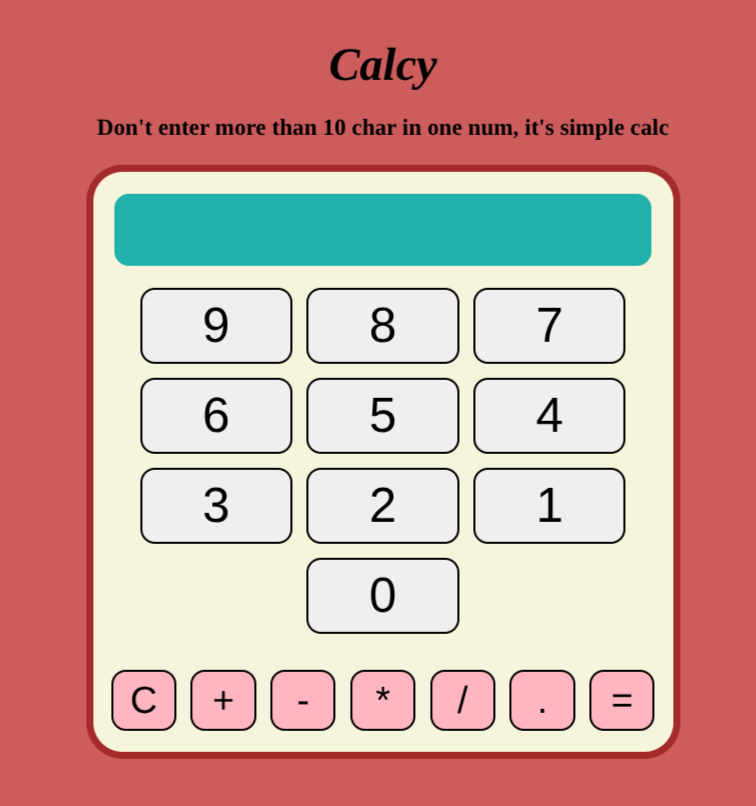

# Calcy
Calcy is a simple browser-based calculator built with HTML, CSS, and JavaScript.

Check preview *[Here](https://morfxmo.github.io/calcy/)*

## Features

- Basic arithmetic operations: addition, subtraction, multiplication, and division
- Decimal support
- Keyboard input support
- Clear button to reset the calculator
- Lightweight and dependency-free
- Simple single-page design

